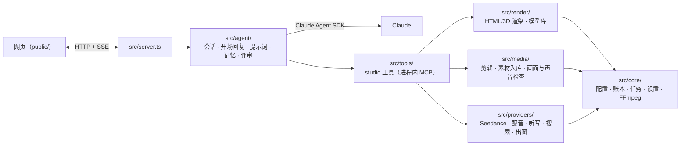

# video agent

对话式 AI 视频制作 demo：用户在聊天里说想要什么视频，agent 负责规划、制作、剪辑，出片后用户接着提修改，agent 只重做受影响的镜头，生成新版本。能做广告、讲解、祝福、故事短片等，也能剪用户上传的素材。

agent 的大脑是 Claude，由 [Claude Agent SDK](https://docs.claude.com/en/api/agent-sdk/overview) 驱动。每个镜头怎么做由 agent 自己决定：

- **代码动画**：文字、价格、图表、logo、片尾等需要精确的画面。agent 写一个 HTML 页面（2D 或 three.js 3D），由无头 Chrome 逐帧渲染。
- **写实镜头**：人物、场景、产品使用等需要真实感的画面，交给 Seedance 生成。
- **资料片和 3D 模型**：从 NASA、Wikimedia Commons、Poly Haven 等公开库检索，自动记录许可和署名。
- **用户素材**：上传的视频、照片、音频和文档。入库时会自动分段、写描述、做画质检查，剪辑时可以统一色彩、防抖、保留现场声。

最后用 FFmpeg 拼接、配音、配乐、烧字幕，并在交付前自检：听写配音、检查黑屏、冻帧、响度。界面为中文聊天应用，手机和桌面都能用。

## 架构



依赖只朝一个方向：`server → agent → tools → render → media → providers → core`（上层可以跳过中间层直接用下层），目录之间没有循环依赖。完整的 agent 架构图见 [docs/agent-architecture.md](docs/agent-architecture.md)，各项能力的具体做法见 [docs/features.md](docs/features.md)。

## 本地运行

需要 Node 22+、Google Chrome、FFmpeg 和中文字体 Noto Sans CJK（如 `fonts-noto-cjk`）。

```sh
npm ci
cp .env.example .env          # 填 API 配置，变量说明见文件里的注释
npx tsx --env-file=.env src/server.ts      # http://127.0.0.1:8787
```

- `.env` 里配置 `ANTHROPIC_BASE_URL` / `ANTHROPIC_API_KEY` 后，Claude 走这个 API；Seedance、配音、听写、搜索、出图走 `SEEDANCE_*` / `RELAY_*` 配置的服务。
- 什么都不配置也能启动：Claude 用本机 Claude Code 的登录，写实镜头用占位片段代替，不产生费用。
- 所有付费调用都记在账本里，超过 `BUDGET_LIMIT_USD` 就拒绝。系统面板（左下角"系统"）里可以看用量、轨迹、记忆和服务状态。
- 视频固定 480p，画幅（9:16、16:9、1:1）由 agent 按投放平台决定。

## 技能

技能是一个带 `SKILL.md` 的文件夹，存放镜头配方、节奏、设计规则这类经验，agent 需要时会加载。

- `skills/video-3d/`：本项目自己写的 3D 镜头技能，在仓库里。
- 第三方技能不进仓库，由管理员安装，例如 [video-shotcraft](https://github.com/Vincentwei1021/video-shotcraft)（Apache-2.0，自带背景音乐；本项目测试用的是提交 `1266a3ec`）：

  ```sh
  npm run skill:add https://github.com/Vincentwei1021/video-shotcraft
  ```

  脚本会浅克隆到 `skills/<名字>`，校验 `SKILL.md`，并记下来源和提交号。装好后在系统面板的"技能"页启用。

## 检查

```sh
npm run check                 # 类型检查 + 所有不花钱的检查
npm run check -- --offline    # 跳过要下载公开文件的检查（资料片、3D 模型库）
npm run check -- compose beats   # 只跑指定的几项
```

检查脚本在 `scripts/checks/`。每项检查用独立的临时数据目录，环境里不带任何 API key，所以不会产生费用，也不会写进 `data/`。用到开发集的检查（`../video_agent_devset`，不在本仓库）在开发集不存在时跳过那部分用例。

`scripts/tools/` 是运维和调试工具：

- `skill-add.ts`：安装技能；
- `memory-cleanup.ts`：清理记忆里的项目事实；
- `chat-e2e.mjs`：像浏览器一样驱动正在运行的服务，会真实调用模型；
- `fake-seedance.mjs`：一个假的 Seedance 接口，用于测试；
- `probe-*.ts`：真实调用一次外部接口，会产生费用。

## 部署

推荐用一台 Linux 服务器（例如 Ubuntu 24.04，8 核 16G，不需要 GPU），安装 Node 22、Google Chrome、FFmpeg、`fonts-noto-cjk` 和 Nginx。`deploy/` 里是 systemd 和 Nginx 的配置模板，路径默认 `/opt/video_agent`，服务用户默认 `videoagent`。

```sh
# 本机：同步代码（不带依赖、数据、密钥和第三方技能），写入版本号
rsync -av --exclude node_modules --exclude data --exclude .git --exclude .env --exclude skills ./ <用户>@<服务器>:/opt/video_agent/
ssh <用户>@<服务器> "echo '{\"commit\":\"$(git rev-parse --short HEAD)\",\"deployedAt\":\"$(date -Iseconds)\"}' > /opt/video_agent/BUILD.json"

# 服务器：首次安装
useradd -m -s /usr/sbin/nologin videoagent
cd /opt/video_agent && npm ci
cp .env.example .env && chmod 600 .env        # 填 API 配置；服务器上没有 Claude Code 登录，必须配 ANTHROPIC_*
mkdir -p data && chown -R videoagent:videoagent /opt/video_agent
cp deploy/video-agent.service /etc/systemd/system/ && systemctl daemon-reload && systemctl enable --now video-agent
cp deploy/nginx.conf /etc/nginx/sites-available/video-agent && ln -s ../sites-available/video-agent /etc/nginx/sites-enabled/
htpasswd -c /etc/nginx/.video-agent.htpasswd <用户名> && nginx -t && systemctl reload nginx
```

- 服务只监听 `127.0.0.1`，由同一台机器上的 Nginx 对外提供访问。
- 应用本身没有登录，额度是所有人共用的，所以要在 Nginx 上开 basic auth（模板里已默认开启），或者在防火墙上只放行自己团队的 IP。
- 模型写的动画页面在隔离环境里渲染：只能读到本会话的素材，外部网络请求一律拦截。

数据都在 `DATA_DIR`（默认 `data/`）下，各文件的格式、读写方和清理策略见 [docs/data.md](docs/data.md)。回收站里的对话 7 天后自动删除（`TRASH_DAYS`），3D 模型缓存超过 2 GB 时按最近使用时间淘汰（`MODEL_CACHE_MAX_MB`）。

## 目录

```
src/
  server.ts        HTTP 服务、SSE 事件流、上传、系统面板接口（入口）
  agent/           会话循环、开场回复、系统提示词、偏好记忆、回合评审、轨迹
  tools/           agent 的工具：index.ts 是注册表，其余每个文件是一组工具
  render/          HTML / three.js 逐帧渲染、3D 模型库
  media/           剪辑与合成、素材入库与描述、上传、画面和声音检查、项目数据
  providers/       外部服务：Seedance、配音、听写、搜索、出图、Claude 结构化调用
  core/            配置、账本、后台任务、设置、技能、FFmpeg 封装
public/            网页前端
vendor/            three.js r186（原样）和 kit3d 3D 细节工具包
skills/video-3d/   3D 镜头技能
scripts/checks/    不花钱的检查（npm run check）
scripts/tools/     运维和调试工具
deploy/            systemd 和 Nginx 配置模板
docs/              架构、功能细节、数据说明
benchmark/         VideoAgentBench：规格、测试工具、素材包校验与获取脚本
```

## Benchmark

`benchmark/` 是 VideoAgentBench：评测对话式视频 agent 的任务规格（v0.3 共 50 题，v0.2 共 3 题）、测试工具和素材包的生成工具。素材包作为 GitHub Release 的附件单独提供，用 `benchmark/scripts/fetch-packs.sh` 获取。详见 [benchmark/README.md](benchmark/README.md)。

## 许可

- 代码：MIT，见 [LICENSE](LICENSE)。
- 文档和调研资料（`docs/`、`reports/`、`research_notes/`）：CC BY 4.0，见 [docs/LICENSE](docs/LICENSE)。
- Benchmark 的规格、素材包和提示词规格：CC BY 4.0，见 [benchmark/LICENSE](benchmark/LICENSE)；`benchmark/` 里的代码同样是 MIT。
- 随仓库分发的第三方文件（three.js、Draco、meshopt、字体）保持各自的许可，见 [THIRD_PARTY.md](THIRD_PARTY.md)。
