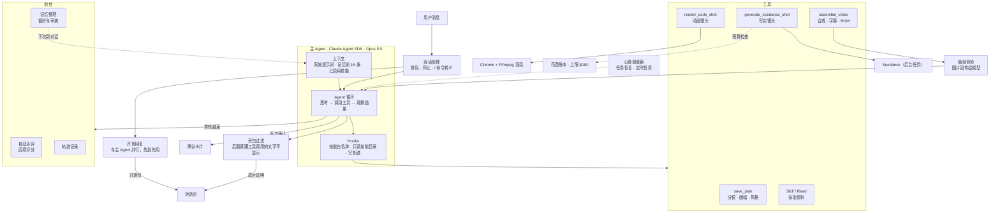

# video agent 架构

虚线框表示规划中、尚未实现的部分。

## 说明

- **开场与主循环分开**：开场句由一次快速调用生成，与主 Agent 并行，哪边先写出来就用哪边；主 Agent 按正常思考深度规划分镜、调用工具。
- **上下文**：系统提示词规定说话方式和视频制作规则，另外附带自动整理的用户偏好（记忆）和已启用的技能。
- **工具**：4 个视频工具，加上只读的技能工具。命令执行等内置工具全部关闭，所有调用都经过 Hooks 检查并写入轨迹。
- **质量闭环**：合成后抽帧交给模型自检；每轮结束后在后台自动评分，并把用户反馈整理进记忆，供后续新对话参考。
- **规划中**：心跳调度器，负责服务重启后恢复任务、执行定时任务，以及后台任务完成后主动跟进。
